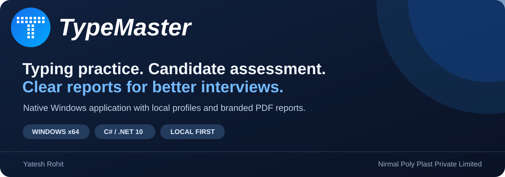

<div align="center">



<p><a href="#features">Features</a> · <a href="#screenshots">Screenshots</a> · <a href="#assessment-workflow">Workflow</a> · <a href="#download-and-run">Download</a> · <a href="#build-from-source">Build</a> · <a href="#documentation">Documentation</a></p>

<p>


<a href="https://github.com/yateshr/TypeMaster/releases/latest"></a>
</p>

**Typing practice, interview assessments and company-branded reports in one native Windows application.**

[Download the latest release](https://github.com/yateshr/TypeMaster/releases/latest) · [Read the user guide](docs/USER_GUIDE.md) · [Report an issue](https://github.com/yateshr/TypeMaster/issues/new/choose)

</div>

## About

Current release: **1.11.10**, fixing typing-test input delays while preserving the approved UI and report design. See [the artwork guide](docs/ARTWORK.md).

TypeMaster was built for a practical interview workflow: a candidate completes a typing test, the examiner records demonstrated computer skills and remarks, and the company receives a readable assessment report.

The application is written in C# with WPF. It runs locally on Windows, keeps candidate profiles on the current Windows account and exports PDF files directly. The distributed Windows build includes the .NET runtime.

## Features

| Area | Available functionality |
|---|---|
| Typing tests | Timed text and number tests, live feedback, completion handling, speed and accuracy results |
| Learning | Structured lessons, keyboard guidance and practice exercises |
| Custom review | Targeted practice for difficult keys |
| Statistics | Saved test history, speed and accuracy charts |
| Technical skills | Searchable catalogue of 521 Excel function names, practical skills, custom entries and application grouping |
| Candidate assessment | Selected skills, free-form remarks and examiner name |
| Reports | Test results, certificate, examination sheet and complete progress report |
| PDF output | Selectable text, embedded fonts, aligned company header, three-column skills, continuation headers and examiner footer on every page |
| Updates | Optional daily GitHub checks, verified installer downloads and user-controlled installation |
| Company branding | Configurable company name and logos; supplied company branding remains the default |
| Data protection | Profile backup and restore, atomic profile saves, backup recovery and interrupted-exercise recovery |
| Practice games | Bubbles, WordTris, Clouds, ABC Speed Race, Pipe Game and Cloud Race |
| Typing Meter | Optional Windows typing activity statistics with pause and stop controls |

Excel, Word and PowerPoint skills are **examiner-entered assessments**. TypeMaster does not automatically execute or grade Office tasks. Function availability varies by the candidate's Excel version.

## Screenshots

These images show the running native application with demonstration profiles.

### Welcome and typing test

| Welcome | Number typing test |
|---|---|
|  |  |

### Learning and statistics

| Studying | Statistics |
|---|---|
|  |  |

### Skills checklist and reports

| Skills and remarks editor | Complete progress report |
|---|---|
|  |  |

### About and updates

| Developer and build information | GitHub updates |
|---|---|
|  |  |

[Browse the complete screenshot gallery](docs/SCREENSHOTS.md) · [Open the sample progress PDF](docs/reports/complete-progress-report.pdf)

## Assessment workflow


1. Create or select a candidate profile.
2. Open **Typing Test**, select the test and duration, and complete the attempt.
3. Open **Statistics → Progress Report → Skills & Remarks**.
4. Select demonstrated skills under Excel, Word, PowerPoint or another relevant application. Add remarks and **Test taken by**.
5. Apply the assessment, review the report and save a PDF or print it.

Selected Excel functions and practical Excel skills share one Excel section. Every typing result uses a compact layout. The examiner name appears at the bottom left of every progress-report page.

## Download and run

Download from [GitHub Releases](https://github.com/yateshr/TypeMaster/releases/latest):

| File | Use |
|---|---|
| `TypeMaster-Native-1.11.10-Setup.exe` | Install for the current Windows account with shortcuts and uninstall support |
| `TypeMaster-Native-1.11.10-win-x64.zip` | Extract the whole archive and run `native-win-x64-1.11.10/TypeMaster.exe` without installing |
| `SHA256SUMS.txt` | Verify release downloads against their published SHA-256 hashes |

Keep every file in the portable folder together. Close TypeMaster and exit the Typing Meter tray icon before updating.

**Requirements:** Windows 10 or Windows 11, x64. The app uses Windows desktop APIs and is not available for macOS, Linux or the browser. The self-contained release does not require a separate .NET installation. The installer is currently unsigned; Windows may display a publisher warning.

## Reports

| Report | Demonstration PDF |
|---|---|
| Complete progress report | [Typing history, application skills, remarks and examiner](docs/reports/complete-progress-report.pdf) |
| Typing test results | [Speed, accuracy and error details](docs/reports/typing-test-results.pdf) |
| Number test results | [Numeric typing results](docs/reports/numeric-test-results.pdf) |
| Certificate | [Typing test certificate](docs/reports/test-certificate.pdf) |
| Examination sheet | [Typed text with mistakes and corrections](docs/reports/assessment-examination-sheet.pdf) |

[Four-attempt short-skills sample](docs/reports/sample-candidate-short-skills.pdf) · [Four-attempt long-skills sample](docs/reports/sample-candidate-long-skills.pdf)

All examples use demonstration candidate data. Company name and logos can be changed through **Settings → Company Branding**.

## Build from source

Install the [.NET 10 SDK](https://dotnet.microsoft.com/download/dotnet/10.0) on Windows. Open `Native/TypeMaster.Native.sln` in a compatible Visual Studio installation or use PowerShell:

```powershell
git clone https://github.com/yateshr/TypeMaster.git
cd TypeMaster
dotnet build Native/TypeMaster.Native.csproj -c Release
dotnet run --project Native/TypeMaster.Native.csproj -c Release
```

To publish the self-contained Windows build, run the WPF checks and package the portable release:

```powershell
& '.\Build Native.ps1'
```

If NSIS is installed, the same script builds the installer. Pass `-NsisPath 'C:\path\to\makensis.exe'` if it is not on PATH. See [BUILDING.md](docs/BUILDING.md) for testing and PDF verification.

## Technology and structure

| Component | Implementation |
|---|---|
| Application | C# / .NET 10 / WPF with Windows interop |
| Storage | Local JSON profiles and backups |
| PDF | Native vector/text exporter with embedded fonts |
| Packaging | Self-contained win-x64 publish, portable ZIP, NSIS installer |
| Assessment catalogue | Offline Excel-function JSON and native skills editor |

```text
TypeMaster/
├── Native/              C# application, solution, tests and tools
├── Asset/               Runtime artwork, lessons, test texts and catalogue
├── UI/                  Reference images required by the build
├── docs/                User guides, screenshots and demonstration reports
├── Build Native.ps1     Publish, verify and package
└── Start TypeMaster.cmd  Run a locally built portable release
```

## Validation and limitations

The typing responsiveness fix and before/after measurements are documented in [performance validation](docs/PERFORMANCE.md).

Release 1.11.10 passed **576 native application checks**. Five sample PDF reports passed text extraction and word-selection hit-area verification. Display checks include small windows and DPI/maximized-frame cases; this does not imply every monitor configuration has been tested.

Typing scores use the currently implemented scoring rules based on supplied report evidence. Source-comparison notes and known scope differences are documented in [Native/REPORTS.md](Native/REPORTS.md) and [Native/SOURCE_GAPS.md](Native/SOURCE_GAPS.md). TypeMaster is a separate application and is not endorsed by TypingMaster or Microsoft.

## Documentation

- [User guide](docs/USER_GUIDE.md)
- [Screenshots](docs/SCREENSHOTS.md)
- [Build and test guide](docs/BUILDING.md)
- [FAQ and troubleshooting](docs/FAQ.md)
- [Release notes](CHANGELOG.md)
- [Contribution guide](CONTRIBUTING.md)
- [Source license](LICENSE) and [asset attribution](THIRD_PARTY_NOTICES.md)

## Author

**Yatesh Rohit** · Nirmal Poly Plast Private Limited

Original TypeMaster source code is released under the MIT license. Supplied artwork, lesson content, reference images and company trademarks retain their respective ownership; see [THIRD_PARTY_NOTICES.md](THIRD_PARTY_NOTICES.md).

### GitHub updates

Open **About > Updates & GitHub** for optional daily checks, verified installer downloads and links to the project and releases. TypeMaster is a typing-practice application customised for computer assessments and candidate reports; skill observations are entered by the examiner. See [update details](docs/UPDATING.md).
