# TypeMaster screenshot gallery

Actual application captures from an isolated demonstration run. Screenshots show sample/test profiles rather than interview candidate records.

## Welcome

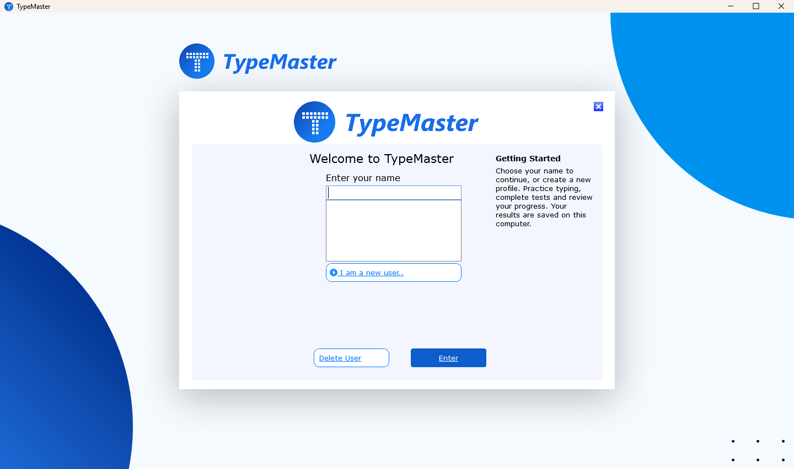

## Typing test

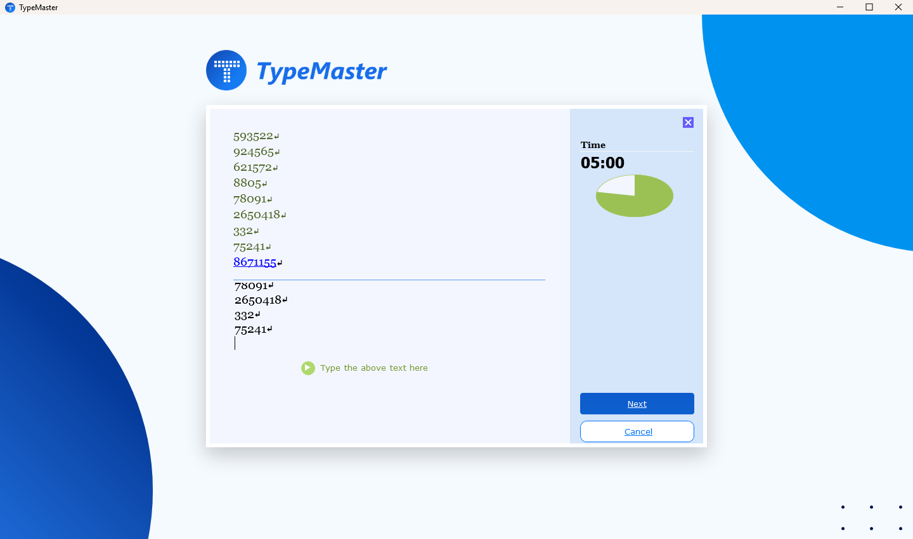

## Completed-word locking

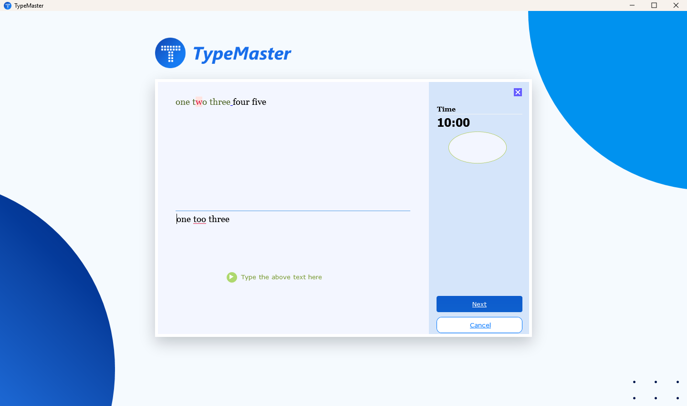

## Studying

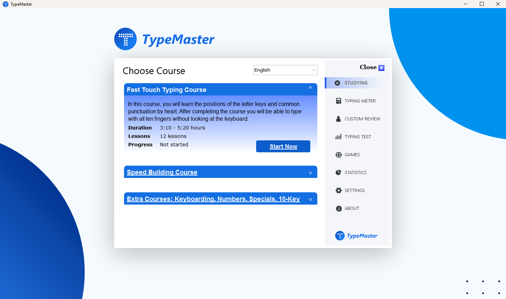

## Statistics

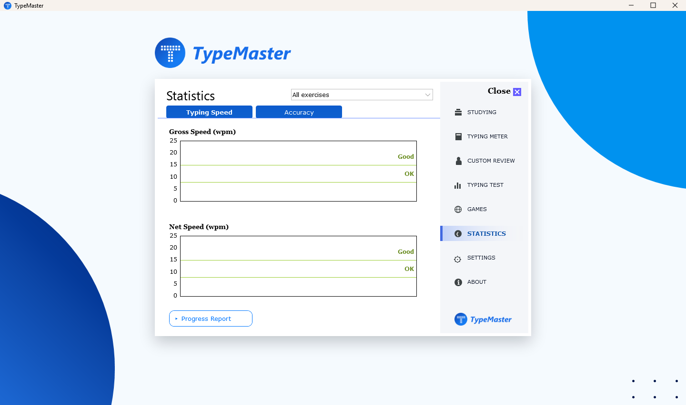

## Skills and remarks

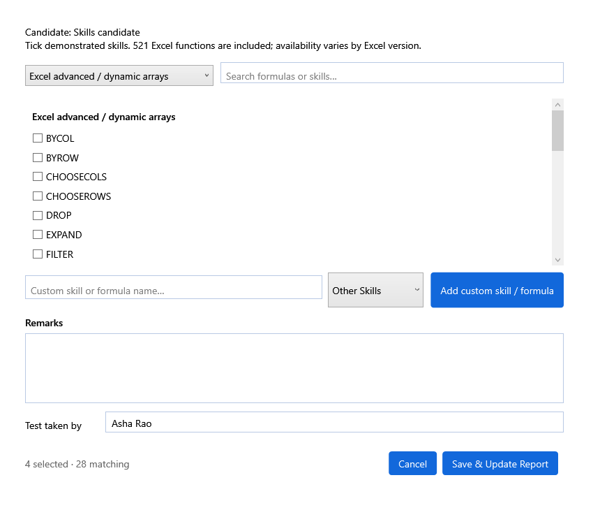

## Progress report

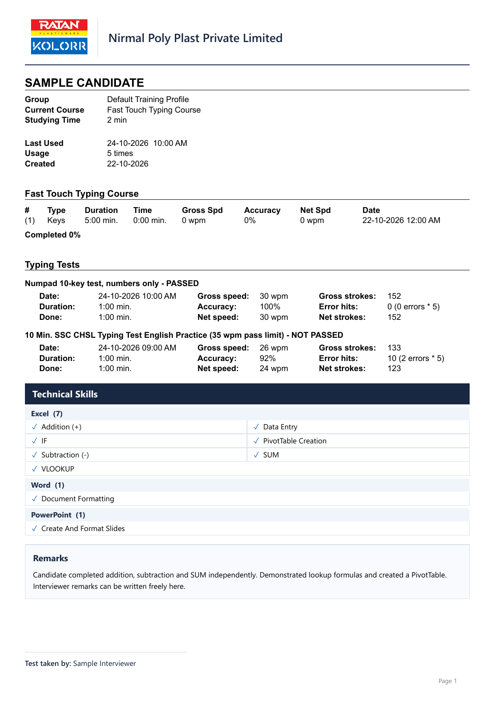

[Download the selectable-text sample PDF](reports/complete-progress-report.pdf).

[Short-skills report, four typing attempts](reports/sample-candidate-short-skills.pdf) · [Long-skills report with continuation page](reports/sample-candidate-long-skills.pdf)

## Settings

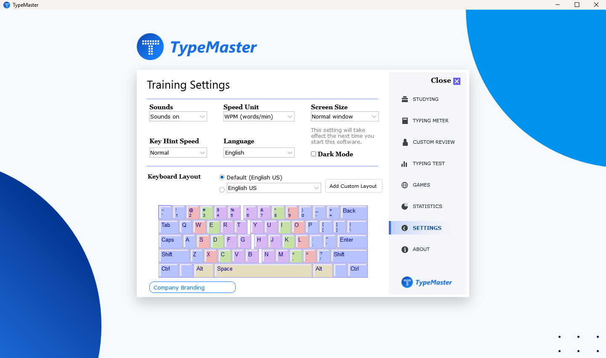

## Games

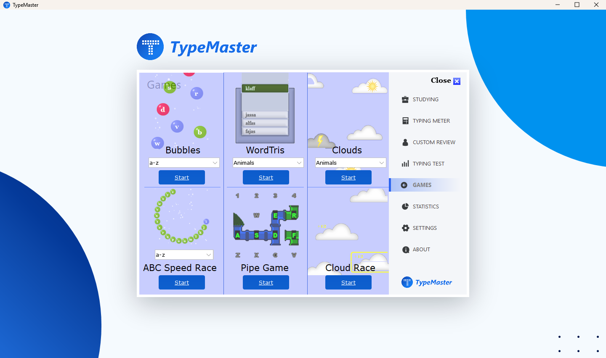

## About

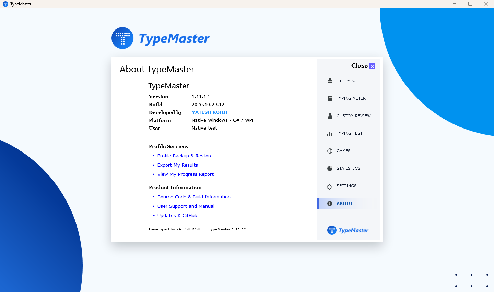

## GitHub updates

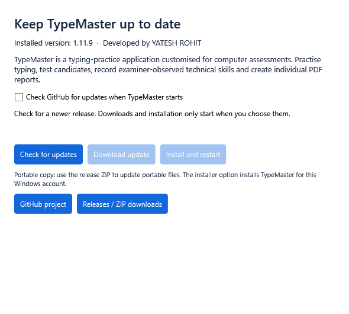

## Original artwork

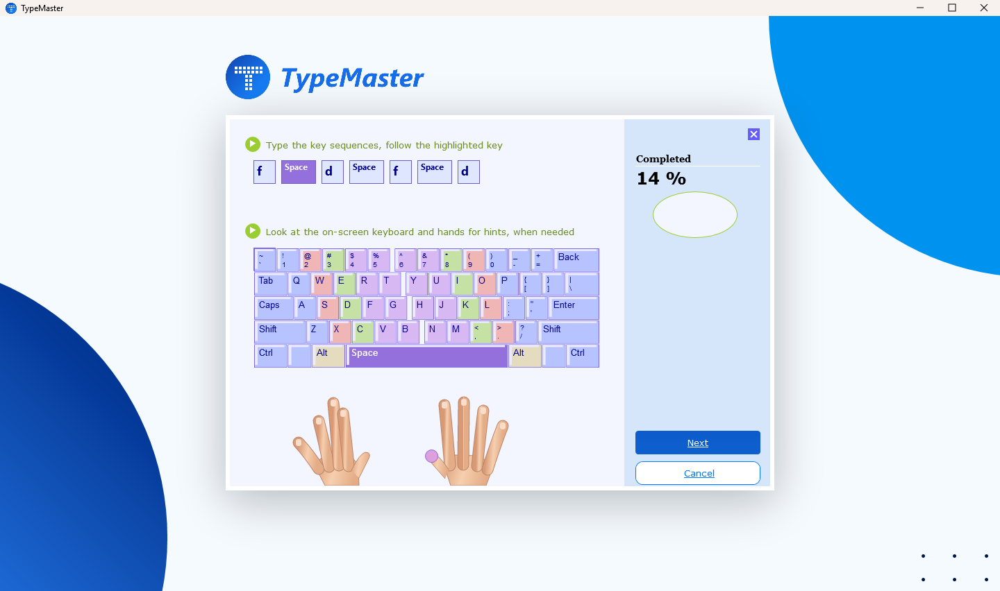
